<!-- datasheet:banner -->
<p align="center">
  <picture>
    <source media="(prefers-color-scheme: dark)" srcset=".github/assets/banner-dark.svg">
    
  </picture>
</p>
<!-- /datasheet:banner -->

# OpenFOAM CFD & Aerodynamics Suite (macOS Apple Silicon & Intel)

A fully integrated, high-performance **OpenCFD OpenFOAM v2512** environment running natively on macOS (Apple Silicon `arm64` and Intel `x86_64`) via Docker, paired with **native macOS ParaView**, **real-time live convergence monitoring**, and a dedicated **Aerodynamics Simulation Toolkit**.

---

<!-- datasheet:figure -->
## At a glance

<p align="center">
  <picture>
    <source media="(prefers-color-scheme: dark)" srcset=".github/assets/diagram-dark.svg">
    
  </picture>
</p>
<!-- /datasheet:figure -->

## 🚀 Quick Start & CLI Tools

All tools are configured in [`bin/`](bin) and added to your `PATH` via [`install_mac.sh`](install_mac.sh):

| Command | Purpose |
| :--- | :--- |
| `openfoam` (or `./openfoam.sh`) | Open interactive OpenFOAM shell or run any OpenFOAM solver/utility |
| `paraFoam [case]` | Automatically launch hardware-accelerated macOS ParaView on the case |
| `foam-live [case]` | Launch real-time web convergence dashboard (`http://localhost:8080`) |
| `foam-aero <cmd>` | Aerodynamics toolkit (AoA setter, polar sweep, lift/drag extraction, flow rendering) |
| `foam-test` | Run the automated 7-step fluid simulation test suite |
| `pvpython <script.py>` | Run macOS ParaView Python scripts for headless rendering & animation generation |

---

## ✈️ Aerodynamic Uses & Workflows

### 1. Angle of Attack (AoA) Adjustment
Easily change the angle of attack $\alpha$ for the 2D NACA airfoil without manually calculating velocity vectors or lift/drag unit vectors:

```bash
# Set Angle of Attack to 4.0 degrees with default 26.0 m/s freestream velocity
foam-aero set-aoa 4.0

# Set Angle of Attack to 12.0 degrees with 50.0 m/s freestream
foam-aero set-aoa 12.0 --speed 50.0
```

`foam-aero set-aoa` automatically updates:
- Velocity field $U = (U_\infty \cos\alpha, U_\infty \sin\alpha, 0)$ in `0.orig/U` and `0/U`.
- Lift direction $(-\sin\alpha, \cos\alpha, 0)$ and Drag direction $(\cos\alpha, \sin\alpha, 0)$ in `system/controlDict`.

### 2. Extract Converged Lift & Drag Coefficients
View the converged aerodynamic forces, lift coefficient $C_l$, drag coefficient $C_d$, pressure drag vs viscous drag, pitching moment $C_m$, and lift-to-drag ratio $L/D$:

```bash
foam-aero forces
```

Output:
```text
============================================================
  Aerodynamic Coefficients Summary: airFoil2D
============================================================
  Converged Iteration / Time:   308
  Lift Coefficient (Cl):        +0.9709
  Drag Coefficient (Cd):        +0.0294
    - Pressure Drag (Cd_p):     +0.0140
    - Friction Drag (Cd_f):     +0.0154
  Pitching Moment (Cm_c/4):     +0.2329
  Lift-to-Drag Ratio (L/D):     +33.07
============================================================
```

### 3. Automated Aerodynamic Polar Sweep
Run an automated polar curve sweep over multiple angles of attack:

```bash
foam-aero polar --angles 0,2,4,6,8,10,12
```

This cleans and runs each simulation point, collects $C_l, C_d, C_m$, and saves `cases/airFoil2D/aerodynamic_polar.csv`.

### 4. High-Resolution Flow Field Rendering
Render publication-quality velocity magnitude and pressure field snapshots:

```bash
foam-aero render
```
Images are rendered to `renders_airfoil/`.

---

## 📊 Real-Time Simulation Viewing

### Option 1: Live Web Convergence Dashboard (`foam-live`)
Launch the real-time browser dashboard:

```bash
foam-live
```
Open **`http://localhost:8080`** in Safari or Chrome:
- **Live Residuals Graph**: interactive logarithmic convergence plot for $p, U_x, U_y, \tilde{\nu}, k, \omega$.
- **Live Aerodynamic Forces**: real-time Lift ($C_l$) and Drag ($C_d$) convergence curve.
- **Live Flow Visualizer**: automatic display of rendered flow field slices.
- **One-Click ParaView**: button to launch native macOS ParaView directly from the browser.

### Option 2: Hardware-Accelerated macOS ParaView (`paraFoam`)
To visualize 3D/2D flow fields, streamline ribbons, vectors, and pressure contours in real time:

```bash
# Inside any case directory:
cd cases/airFoil2D
paraFoam

# Or from anywhere:
paraFoam cases/airFoil2D
```

**Real-Time Viewing in ParaView:**
1. In ParaView, check **Auto Apply** (in the toolbar or Edit → Settings → General → Auto Apply).
2. Open the `.foam` file.
3. While the simulation is running in Docker, click the **Reload Files** button or drag the time slider to view newly computed time steps!

---

## 🧪 Fluid Simulation Test Suite

Run the automated validation suite to test all CFD disciplines:

```bash
foam-test
```

Tests executed:
1. **Environment**: Docker daemon, CPU/RAM, and ARM64 Apple Silicon engine check.
2. **Mesh Generation**: `blockMesh` on structured 3D grid.
3. **Laminar Fluid Sim**: `icoFoam` on Lid-Driven Cavity benchmark.
4. **Multiphase VOF Fluid Sim**: `interFoam` on Dam Break collapsing water column.
5. **Aerodynamics RANS**: `simpleFoam` on NACA airfoil with lift & drag convergence.
6. **Parallel MPI Scaling**: 8-core domain decomposition and multi-process solver.
7. **ParaView Offscreen GPU Rendering**: `pvpython` headless render pipeline.

---

## 📁 Available Simulation Cases

| Case | Solver | Physics & Application |
| :--- | :--- | :--- |
| [`cases/airFoil2D`](cases/airFoil2D) | `simpleFoam` | External Aerodynamics: NACA 0012 airfoil ($C_l, C_d, C_m, y^+$, residuals) |
| [`cases/damBreak`](cases/damBreak) | `interFoam` | Multiphase Volume-of-Fluid (VOF) collapsing liquid column & obstacle splash |
| [`cases/pitzDaily`](cases/pitzDaily) | `pimpleFoam` | Transient Turbulent vortex shedding over backward-facing step |
| [`cases/cavity`](cases/cavity) | `icoFoam` | Classic 2D Lid-Driven Cavity laminar benchmark |

To run any case:
```bash
cd cases/<case_name>
openfoam ./Allrun
```
